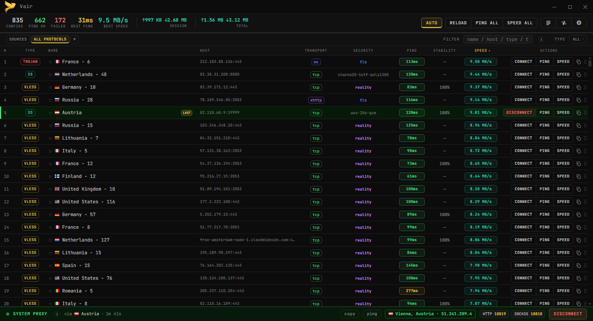
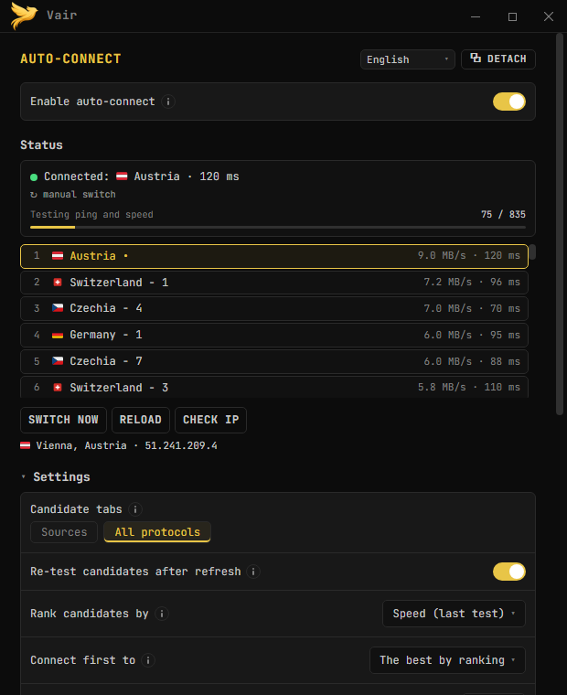
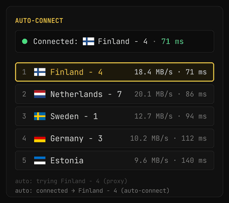
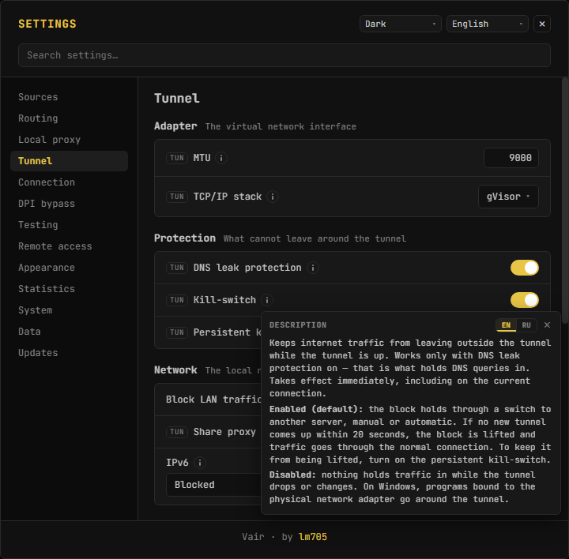
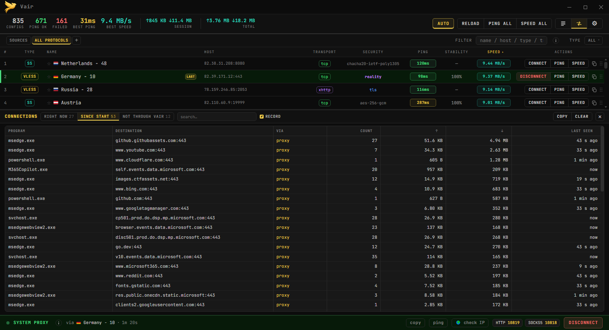
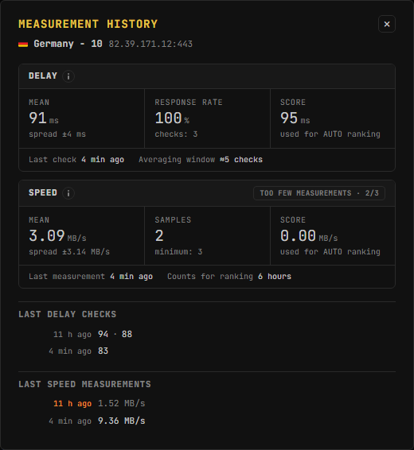

# Vair

**Русский** | [English](README_EN.md) | [فارسی](README_FA.md) | [中文](README_ZH.md)

[](https://github.com/lm705/vair/releases)
[](https://github.com/lm705/vair/releases/latest)

[](LICENSE)
[](https://github.com/lm705/vair/stargazers)

VPN-клиент для проверки и подключения к конфигурациям протоколов **VLESS, VMess, Trojan, Shadowsocks (включая SS2022), Hysteria2, TUIC, WireGuard**, а также обычных прокси **SOCKS5, HTTP и HTTPS**. Построен на базе [Xray-core](https://github.com/XTLS/Xray-core) и [sing-box](https://github.com/SagerNet/sing-box).

**Можно начать без своих конфигураций:** внутри уже есть список бесплатных конфигураций, который обновляется каждый час и проходит автопроверку. В режиме [**AUTO**](https://github.com/lm705/vair/wiki/Авто-подключение) программа сама тестирует конфигурации, подключается к самой быстрой рабочей и переключается на другую, если та перестала отвечать. А авто-обновление вкладки будет держать сам список конфигураций актуальным — свежие подтянутся без вашего участия.

Свои конфигурации тоже никуда не деваются: **подписки по ссылке**, файлы и отдельные конфигурации раскладываются по вкладкам и работают с теми же тестами, маршрутизацией и AUTO.

**Windows и Linux.** На Windows — установщик `Vair_<версия>_setup.exe`: он ставит программу для всех пользователей вместе с небольшой службой-помощником, и дальше Vair работает без прав администратора, включая режим TUN и kill-switch; или портативный `Vair.exe` с движками внутри (запускается без установки, для TUN — от имени администратора). На Linux — пакеты `.deb`, `.rpm` и Arch; движки ставятся и обновляются вместе с пакетом.

<a href="screenshots/main-window.png"></a> <a href="screenshots/auto-panel.png"></a>

<details>
<summary><b>Ещё скриншоты</b></summary>

<br>

**AUTO уходит с сервера, который перестал отвечать (иллюстрация)**



**Настройки: раздел Tunnel и описание kill-switch**

<a href="screenshots/settings.png"></a>

**Панель Connections: какие программы и куда ходят через Vair**

<a href="screenshots/connections.png"></a>

**История замеров конфигурации**

<a href="screenshots/history.png"></a>

</details>

## Обратная связь

* Новости, релизы и тестовые сборки — в Telegram-канале [**t.me/vair705**](https://t.me/vair705).
* Предложения, ошибки и любые пожелания, пожалуйста, пишите в [**Issues**](https://github.com/lm705/vair/issues). Писать можно на удобном вам языке.
* Для связи напрямую — Telegram: [**t.me/mial705**](https://t.me/mial705).

## Быстрый старт

1. Скачайте со страницы [**Releases**](https://github.com/lm705/vair/releases): на Windows — `Vair_<версия>_setup.exe` (установщик) или `Vair.exe` (портативный, запускается без установки); на Linux — пакет для вашего дистрибутива (`.deb`, `.rpm` или `.pkg.tar.zst`).

   На Linux поставьте скачанный пакет:

   ```bash
   sudo apt install ./vair_*_amd64.deb             # Debian, Ubuntu, Kali
   sudo dnf install ./vair-*.x86_64.rpm            # Fedora
   sudo pacman -U ./vair-*-x86_64.pkg.tar.zst      # Arch
   ```

   Файлы для Windows не подписаны, поэтому при первом запуске Windows может показать окно «Система Windows защитила ваш компьютер» (Windows protected your PC): нажмите «Подробнее» → «Выполнить в любом случае».

2. Откройте вкладку **SOURCES** и нажмите **RELOAD** — загрузится свежий список конфигураций.
3. Нажмите **PING ALL** или **SPEED ALL**, чтобы проверить их, и подключитесь к любой рабочей — или включите **AUTO**, и программа сделает это сама.

Подробнее — [Начало работы](https://github.com/lm705/vair/wiki/Начало-работы) в Wiki.

## Системные требования

* **Windows 10 или 11**, 64-битная, с WebView2 Runtime: в Windows 11 он встроен, а если его нет, установщик поставит его сам.
* **Linux x86_64** с GTK 4.10+ и WebKitGTK 6.0: Ubuntu 24.04+, Debian 13+, свежие Fedora и Arch, Kali. Ubuntu 22.04 не подойдёт.
* Движки xray-core и sing-box поставляются вместе с программой.

## Возможности

* **Протоколы** — VLESS / VMess / Trojan / Shadowsocks / SS2022 / Hysteria2 / TUIC / WireGuard, а также SOCKS5, HTTP и HTTPS-прокси, с TLS и Reality.
* **Два режима** — системный прокси (HTTP/SOCKS) и TUN: весь трафик через туннель.
* [**Авто-подключение (AUTO)**](https://github.com/lm705/vair/wiki/Авто-подключение) — подключается к самому быстрому рабочему конфигу и переключается, когда тот перестаёт отвечать.
* **Тестирование** — задержка и скорость по каждому конфигу, в том числе пакетно; результаты сохраняются между запусками и складываются в историю. Плюс проверка того, какие сервисы открываются с какого сервера.
* **Маршрутизация** — пять режимов: всё через VPN; всё, кроме сайтов выбранных стран (🇷🇺 🇨🇳 🇮🇷 🇰🇿); только заблокированное в РФ; только заблокированное в Китае; только выбранные сайты. Плюс свои правила для доменов, IP и приложений.
* **Защита от утечек** — kill-switch и защита от утечек DNS в TUN-режиме, на Windows и на Linux; блокировка, переживающая закрытие программы (Windows); проверка утечек после каждого подключения (Windows); выбор, что делать с IPv6.
* **Видно, что идёт через туннель** — панель соединений: программа, назначение, применённое правило и трафик, отдельной таблицей — то, что идёт мимо VPN.
* **Цепочки и обход DPI** — соединение через несколько узлов подряд; фрагментация TLS-рукопожатия и браузерный TLS-отпечаток (uTLS).
* **Вкладки и источники** — подписки по ссылке, файлы и приватный репозиторий GitHub, авто-обновление и фильтры; списки до ~250 000 конфигураций работают плавно (SQLite).
* **VPN на телефоне** — раздача прокси по локальной сети из TUN-режима и [управление программой с телефона](https://github.com/lm705/pc-vpn-to-phone).
* **Удобства** — QR-коды, создание конфигураций вручную, в том числе из JSON для Xray и sing-box, самообновление, автозапуск, тёмная и светлая темы, русский и английский интерфейс.

## Документация

* [**Wiki**](https://github.com/lm705/vair/wiki) — полное руководство: настройки, режимы, маршрутизация, цепочки, тестирование, FAQ.
* 📱 [**Как пользоваться VPN этого ПК на телефоне**](https://github.com/lm705/pc-vpn-to-phone) — раздача по Wi-Fi и доступ из любой точки через Tailscale.

## vless_alive.txt и all_alive.txt

Список бесплатных VLESS-конфигураций, работающих на территории России.

Предзагружен во вкладку **SOURCES** программы. Кнопка **RELOAD** подгружает свежую версию файла.

`all_alive.txt` отличается тем, что в нём собраны конфигурации всех протоколов: VLESS, VMess, Trojan, Shadowsocks, Hysteria2 и TUIC.

Конфигурации обновляются каждый час, проходя автоматическую проверку на доступность и скорость на сервере в одном из самых глухих в плане блокировок регионов России. Недоступные и медленные конфигурации отфильтровываются. Большинство конфигураций работоспособны на момент обновления.

> ⚠️ **С 19 октября 2026 года список перестаёт обновляться каждый час.** Я сменил местоположение (и вам рекомендую — времени меньше, чем кажется), поэтому больше не могу поддерживать регулярное обновление. Список продолжит обновлять другой человек — по мере свободного времени, без расписания. Проверка на доступность и скорость сохраняется, но конфигурации могут быть менее свежими, чем раньше, поэтому имеет смысл добавить и свои источники.

Конфигурации собираются из открытых источников. Сбор и автоматическая проверка выполняются скриптом [vair-collector](https://github.com/lm705/vair-collector).

Страна в названии может отличаться от выходного IP.

## Дисклеймер

Данное программное обеспечение предоставляется «как есть» (*as is*), без каких-либо явных или подразумеваемых гарантий.

Программа является техническим инструментом для работы с сетевыми протоколами. **Это не реклама, не продвижение и не предоставление VPN-услуг.** Программа не является VPN-провайдером, не содержит собственных серверов и не оказывает услуг по обеспечению доступа к заблокированным ресурсам.

Файлы `vless_alive.txt` и `all_alive.txt` содержат конфигурации, собранные из открытых источников в сети Интернет. Автор не является владельцем, оператором и не контролирует серверы, указанные в конфигурациях. Доступность, безопасность и конфиденциальность при использовании этих серверов не гарантируется.

Пользователь самостоятельно несёт полную ответственность за соблюдение законодательства своей юрисдикции при использовании данного ПО.

>## Поддержка
>
>[DALINK](https://dalink.to/lm705) (для отображения валюты RUB заходите без VPN)
>
>Информация о "платежных" адресах размещена в ознакомительных целях. 
>
>ERC20:
>
>```
>0x37072eb42019a258a801df002e5c8d5542709165
>```
>
>TRC20:
>
>```
>TGz3wkGFL7PNjSoxpDnM5WgXEvod3qfz3k
>```
>
>SOL:
>
>```
>F7pVS8N74ARDJYmiTqFeViRVHZhXJ8toJsxyrmWstfmi
>```
>
>TON:
>
>```
>UQBxGaG0hBVKarg6TJVaqvCN0hOFAodQjnCZ9rdnUaWxcbDV
>```

## Статистика репозитория

<a href="https://www.star-history.com/?repos=lm705%2Fvair&type=date&legend=top-left">
 <picture>
   <source media="(prefers-color-scheme: dark)" srcset="https://api.star-history.com/chart?repos=lm705/vair&type=date&theme=dark&legend=top-left&sealed_token=s9Mau_7UPLeko_Ss-eqOe8ikw84z-4uCrMQHEW5p80tUkU11etLD94YMXL309vnuSuOVC--xSK3PZffYkDHUv5Wvfv8irHsn2W6D8NgbQJasCtptbCqpnMyCNbceKc9tV5DGkzozcTxHlkooUzf9pJ-2rKVQ5KFeKz-T79cI3bkcUnYlKKyejM5yuXT1" />
   <source media="(prefers-color-scheme: light)" srcset="https://api.star-history.com/chart?repos=lm705/vair&type=date&legend=top-left&sealed_token=s9Mau_7UPLeko_Ss-eqOe8ikw84z-4uCrMQHEW5p80tUkU11etLD94YMXL309vnuSuOVC--xSK3PZffYkDHUv5Wvfv8irHsn2W6D8NgbQJasCtptbCqpnMyCNbceKc9tV5DGkzozcTxHlkooUzf9pJ-2rKVQ5KFeKz-T79cI3bkcUnYlKKyejM5yuXT1" />
   
 </picture>
</a>
