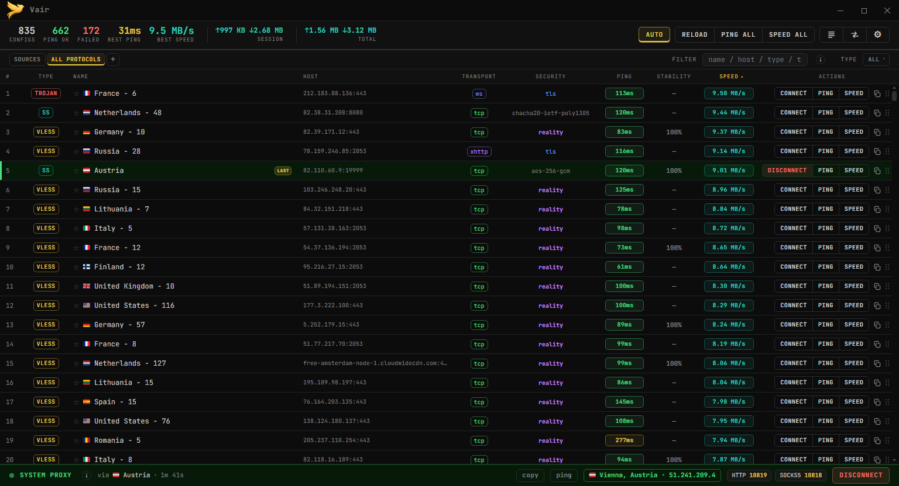
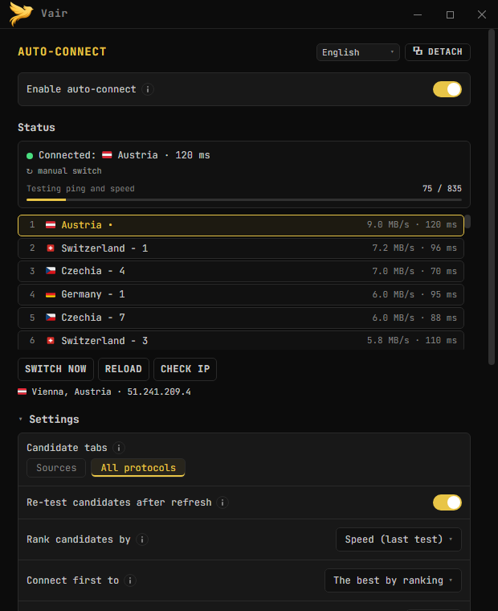
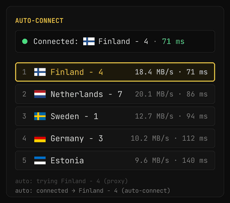
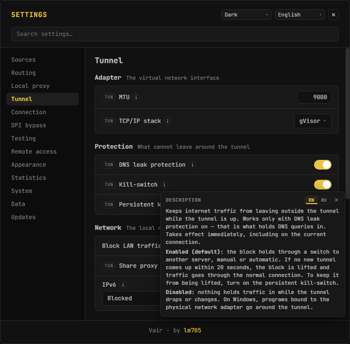
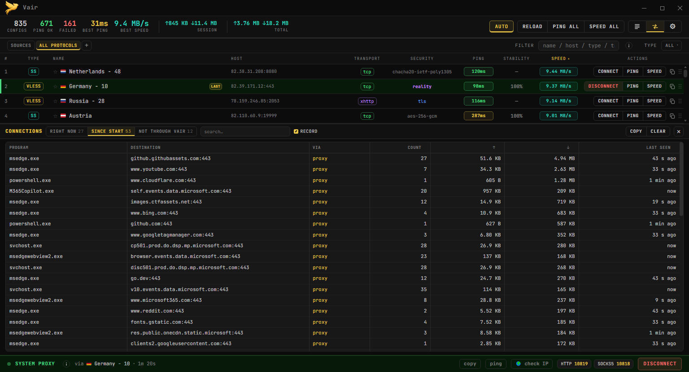
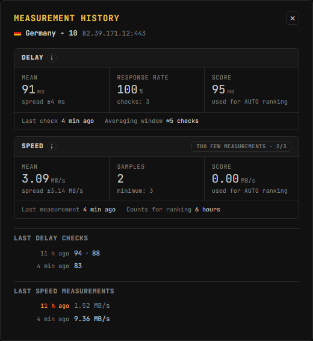

# Vair

[Русский](README.md) | **English** | [فارسی](README_FA.md) | [中文](README_ZH.md)

[](https://github.com/lm705/vair/releases)
[](https://github.com/lm705/vair/releases/latest)

[](LICENSE)
[](https://github.com/lm705/vair/stargazers)

> ⚠️ This is an AI translation and may be inaccurate. The [Russian version](README.md) is the source of truth.

Vair is a VPN client for Windows and Linux. It tests and connects configurations of the **VLESS, VMess, Trojan, Shadowsocks (including SS2022), Hysteria2, TUIC, WireGuard** protocols, as well as ordinary **SOCKS5, HTTP and HTTPS** proxies. It runs on the [Xray-core](https://github.com/XTLS/Xray-core) and [sing-box](https://github.com/SagerNet/sing-box) engines.

**You can start without configurations of your own:** the **SOURCES** tab already holds a list of free ones that is refreshed regularly and checked automatically. In [**AUTO**](https://github.com/lm705/vair/wiki/Авто-подключение) mode the app tests the configurations itself, connects to the fastest working one and switches to another if it stops responding. The **RELOAD** button fetches the latest version of the list.

> ℹ️ **Note:** that built-in list is collected and tested **inside Russia only**, so it may not work in your country. In that case add your own subscriptions and configurations — everything below works exactly the same with them.

You can add your own too: **subscription links**, files and individual configurations sort into tabs, and the same testing, routing and AUTO work for them.

**Windows and Linux:**

* **Windows, installer** `Vair_<version>_setup.exe` — installs the program for all users together with a small helper service. After that Vair runs without administrator rights, TUN mode and the kill-switch included.
* **Windows, portable** `Vair.exe` — runs without installation, engines inside. For TUN mode it has to be run as administrator.
* **Linux** — `.deb`, `.rpm` and Arch packages; the engines are installed and updated with the package.

<a href="screenshots/main-window.png"></a> <a href="screenshots/auto-panel.png"></a>

<details>
<summary><b>More screenshots</b></summary>

<br>

**AUTO leaves a server that stopped answering (illustration)**



**Settings: the Tunnel section and the kill-switch description**

<a href="screenshots/settings.png"></a>

**The Connections panel: which programs go where through Vair**

<a href="screenshots/connections.png"></a>

**A configuration's measurement history**

<a href="screenshots/history.png"></a>

</details>

## Feedback

* **News and releases** — the Telegram channel [**t.me/vair705**](https://t.me/vair705) *(in Russian)*. The 3.0.0 test builds will be published there too.
* **Bugs and suggestions** — in [**Issues**](https://github.com/lm705/vair/issues), in any language.
* **Write to me directly** — Telegram [**t.me/mial705**](https://t.me/mial705).
* **Discussion** — the chat [**t.me/vair705chat**](https://t.me/vair705chat).

## Quick start

1. Download from the [**Releases**](https://github.com/lm705/vair/releases) page: `Vair_<version>_setup.exe` (the installer) or `Vair.exe` (portable, runs with no installation).

   On Linux, install the downloaded package:

   ```bash
   sudo apt install ./vair_*_amd64.deb             # Debian, Ubuntu, Kali
   sudo dnf install ./vair-*.x86_64.rpm            # Fedora
   sudo pacman -U ./vair-*-x86_64.pkg.tar.zst      # Arch
   ```

   The Windows files are not signed, so on the first launch Windows may show “Windows protected your PC”: click “More info” → “Run anyway”.

2. Open the **SOURCES** tab and press **RELOAD** — a fresh list of configurations is fetched.
3. Press **PING ALL** or **SPEED ALL** to check them and connect to any working one — or turn on **AUTO** and the app will do it for you.

More in [Getting started](https://github.com/lm705/vair/wiki/Начало-работы) in the Wiki.

## System requirements

* **Windows 10 or 11**, 64-bit, with the WebView2 Runtime: built into Windows 11, and the installer adds it when it is missing.
* **Linux x86_64** with GTK 4.10+ and WebKitGTK 6.0: Ubuntu 24.04+, Debian 13+, recent Fedora and Arch, Kali. Ubuntu 22.04 will not do.
* The xray-core and sing-box engines come with the program.

## Features

* **Protocols.** VLESS, VMess, Trojan, Shadowsocks (including SS2022), Hysteria2, TUIC and WireGuard, as well as SOCKS5, HTTP and HTTPS proxies. TLS and REALITY are supported.
* **Connection modes.** System proxy (HTTP/SOCKS) or TUN, which captures all system traffic.
* [**Auto-connect (AUTO)**](https://github.com/lm705/vair/wiki/Авто-подключение). Picks the fastest working configuration and switches to another one when the server stops responding.
* **Testing.** Latency and speed of each configuration, one at a time or in bulk. Results persist between launches and build up a measurement history. A separate check shows which services are reachable through each server.
* **Routing.** Five modes: all traffic through the VPN; everything except the sites of selected countries (🇷🇺 🇨🇳 🇮🇷 🇰🇿); only resources blocked in Russia; only resources blocked in China; only selected sites. Custom rules for domains, IP addresses and applications on top.
* **Leak protection.** A kill-switch and DNS protection in TUN mode and a leak check after every connection, on Windows and Linux. On Windows, also a block that stays in place after the program is closed. IPv6 handling is configured separately.
* **Connection monitoring.** The connections panel shows the program, destination, applied rule and traffic volume; connections that bypass the VPN are listed in a separate table.
* **Chains and DPI bypass.** Connections through several servers in sequence; TLS handshake fragmentation and a browser TLS fingerprint (uTLS).
* **Configuration management.** Tabs, subscription links, files and private GitHub repositories, scheduled refresh and filters. Lists of up to ~250,000 configurations work without noticeable lag (stored in SQLite).
* **Phone access.** Proxy sharing over the local network from TUN mode and [controlling the app from a phone](https://github.com/lm705/pc-vpn-to-phone).
* **Other.** QR codes; manual configuration creation, including raw Xray and sing-box JSON; checking for and downloading updates; autostart; dark and light themes; Russian and English interface.

## Documentation

* [**Wiki**](https://github.com/lm705/vair/wiki) — the full manual: settings, modes, routing, chains, testing, FAQ. *(in Russian)*
* 📱 [**How to use this PC's VPN on your phone**](https://github.com/lm705/pc-vpn-to-phone) — sharing over Wi-Fi and access from anywhere via Tailscale.

## vless_alive.txt and all_alive.txt

A list of free VLESS configurations that work within Russia.

Preloaded in the **SOURCES** tab of the application. The **RELOAD** button fetches the latest version of the file.

`all_alive.txt` differs in that it holds configurations of every protocol: VLESS, VMess, Trojan, Shadowsocks, Hysteria2 and TUIC.

Configurations are updated every hour, passing automatic availability and speed checks on a server located in one of the most heavily censored regions of Russia. Unavailable and slow configurations are filtered out. Most configurations are functional at the time of each update.

> ⚠️ **From 19 October 2026 the list is no longer updated hourly.** I have moved (and I recommend the same — there is less time than it seems), so I can no longer keep up a regular schedule. Someone else will keep updating it in their free time, without a fixed cadence. The availability and speed checks stay, but the configurations may be less fresh than before — it is worth adding sources of your own as well.

Configurations are collected from open public sources. Collection and automatic checking are done by the [vair-collector](https://github.com/lm705/vair-collector) script.

The country listed in the name may differ from the actual exit IP.

## Disclaimer

This software is provided "as is", without any express or implied warranties.

The program is a technical tool for working with network protocols. **This is not advertising, promotion, or provision of VPN services.** The program is not a VPN provider, does not include its own servers, and does not provide services for accessing blocked resources.

The `vless_alive.txt` and `all_alive.txt` files contain configurations collected from publicly available sources on the Internet. The author is not the owner or operator of, and does not control, the servers listed in the configurations. Availability, security, and privacy when using these servers are not guaranteed.

The user bears full and sole responsibility for compliance with the laws of their jurisdiction when using this software.

>## Support
>
>[DALINK](https://dalink.to/lm705) (open it without a VPN for prices to show in RUB)
>
>The "payment" address information is provided for informational purposes only.
>
>ERC20:
>
>```
>0x37072eb42019a258a801df002e5c8d5542709165
>```
>
>TRC20:
>
>```
>TGz3wkGFL7PNjSoxpDnM5WgXEvod3qfz3k
>```
>
>SOL:
>
>```
>F7pVS8N74ARDJYmiTqFeViRVHZhXJ8toJsxyrmWstfmi
>```
>
>TON:
>
>```
>UQBxGaG0hBVKarg6TJVaqvCN0hOFAodQjnCZ9rdnUaWxcbDV
>```

## Repository statistics

<a href="https://www.star-history.com/?repos=lm705%2Fvair&type=date&legend=top-left">
 <picture>
   <source media="(prefers-color-scheme: dark)" srcset="https://api.star-history.com/chart?repos=lm705/vair&type=date&theme=dark&legend=top-left&sealed_token=s9Mau_7UPLeko_Ss-eqOe8ikw84z-4uCrMQHEW5p80tUkU11etLD94YMXL309vnuSuOVC--xSK3PZffYkDHUv5Wvfv8irHsn2W6D8NgbQJasCtptbCqpnMyCNbceKc9tV5DGkzozcTxHlkooUzf9pJ-2rKVQ5KFeKz-T79cI3bkcUnYlKKyejM5yuXT1" />
   <source media="(prefers-color-scheme: light)" srcset="https://api.star-history.com/chart?repos=lm705/vair&type=date&legend=top-left&sealed_token=s9Mau_7UPLeko_Ss-eqOe8ikw84z-4uCrMQHEW5p80tUkU11etLD94YMXL309vnuSuOVC--xSK3PZffYkDHUv5Wvfv8irHsn2W6D8NgbQJasCtptbCqpnMyCNbceKc9tV5DGkzozcTxHlkooUzf9pJ-2rKVQ5KFeKz-T79cI3bkcUnYlKKyejM5yuXT1" />
   
 </picture>
</a>
