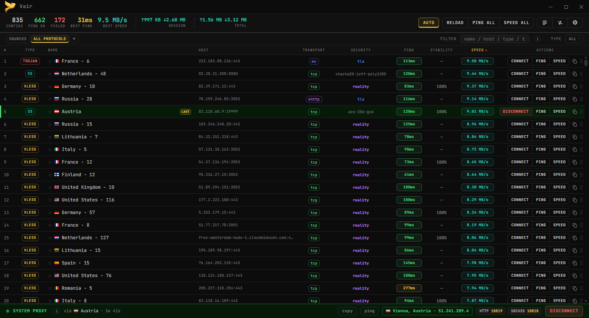
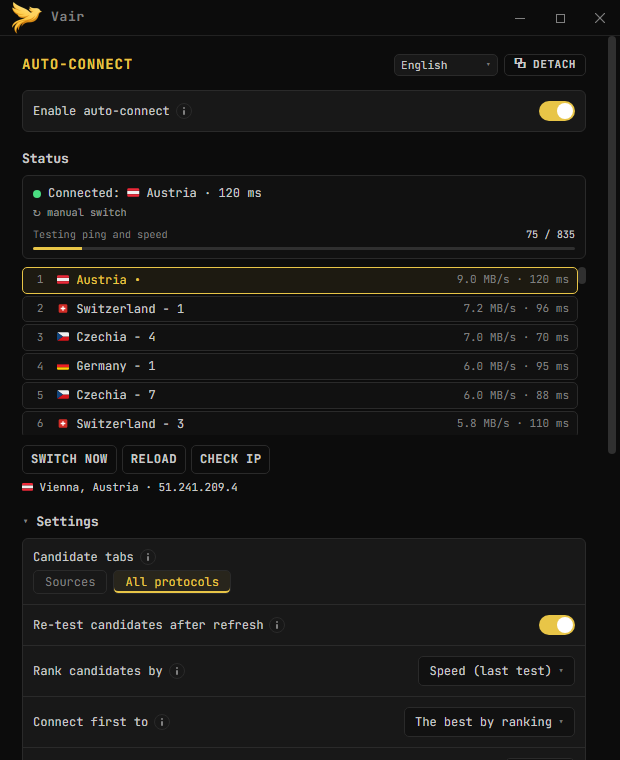
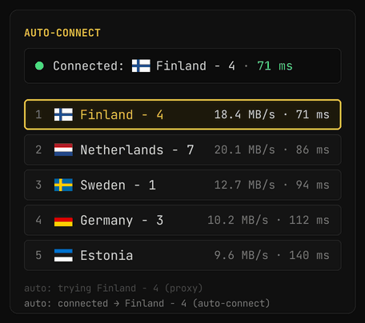
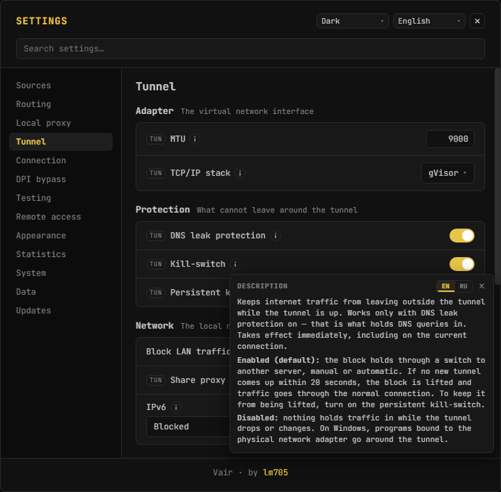
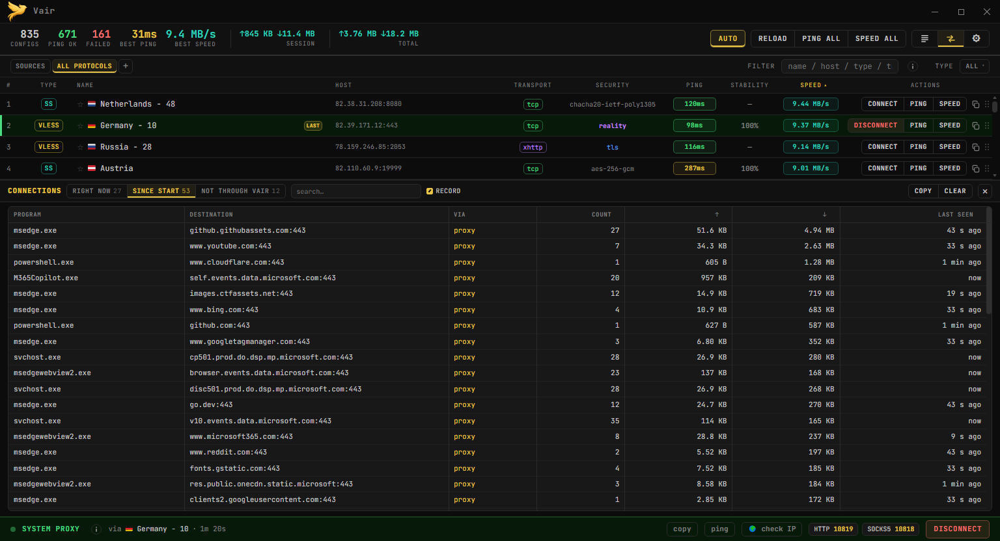
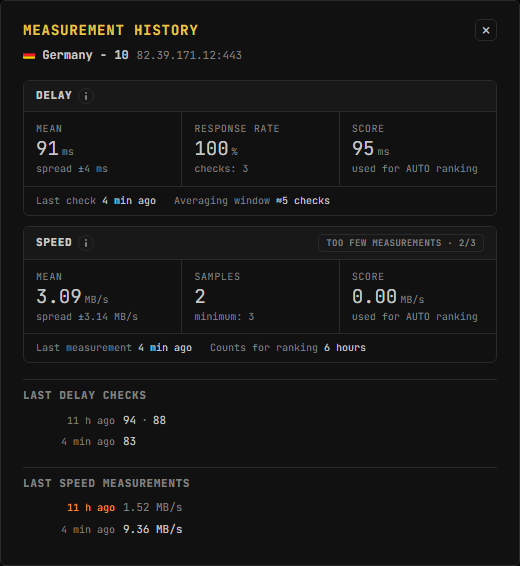

# Vair

[Русский](README.md) | [English](README_EN.md) | **فارسی** | [中文](README_ZH.md)

[](https://github.com/lm705/vair/releases)
[](https://github.com/lm705/vair/releases/latest)

[](LICENSE)
[](https://github.com/lm705/vair/stargazers)

> ⚠️ این ترجمه توسط هوش مصنوعی انجام شده و ممکن است نادقیق باشد. نسخهٔ [روسی](README.md) مرجع اصلی است.

Vair یک کلاینت VPN برای Windows و Linux است. پیکربندی‌هایی با پروتکل‌های **VLESS، VMess، Trojan، Shadowsocks (شامل SS2022)، Hysteria2، TUIC، WireGuard** و همچنین پروکسی‌های معمولی **SOCKS5، HTTP و HTTPS** را آزمایش و وصل می‌کند. بر پایهٔ موتورهای [Xray-core](https://github.com/XTLS/Xray-core) و [sing-box](https://github.com/SagerNet/sing-box) کار می‌کند.

**می‌توانید بدون داشتن پیکربندی شخصی شروع کنید:** در تب **SOURCES** از پیش فهرستی از پیکربندی‌های رایگان هست که به‌طور منظم به‌روزرسانی و به‌صورت خودکار بررسی می‌شود. در حالت [**AUTO**](https://github.com/lm705/vair/wiki/Авто-подключение) برنامه خودش پیکربندی‌ها را آزمایش می‌کند، به سریع‌ترین گزینهٔ سالم وصل می‌شود و اگر از کار افتاد به گزینهٔ دیگری سوئیچ می‌کند. دکمهٔ **RELOAD** نسخهٔ تازهٔ فهرست را دریافت می‌کند.

> ℹ️ **توجه:** این فهرست داخلی فقط **در خاک روسیه** جمع‌آوری و آزمایش می‌شود، بنابراین ممکن است در کشور شما کار نکند. در این صورت اشتراک‌ها و پیکربندی‌های خودتان را اضافه کنید — همهٔ امکانات زیر با آن‌ها هم دقیقاً به همین شکل کار می‌کند.

پیکربندی‌های خودتان را هم می‌توانید اضافه کنید: **لینک اشتراک**، فایل و پیکربندی‌های تکی در تب‌ها مرتب می‌شوند و همان آزمایش‌ها، مسیریابی و AUTO برای آن‌ها هم کار می‌کند.

**Windows و Linux:**

* **Windows، نصب‌کننده** `Vair_<version>_setup.exe` — برنامه را برای همهٔ کاربران همراه با یک سرویس کمکی کوچک نصب می‌کند. پس از آن Vair بدون دسترسی مدیر کار می‌کند، از جمله حالت TUN و kill-switch.
* **Windows، قابل حمل** `Vair.exe` — بدون نصب اجرا می‌شود و موتورها داخل آن هستند. برای حالت TUN باید با دسترسی مدیر اجرا شود.
* **Linux** — بسته‌های `.deb`، `.rpm` و Arch؛ موتورها همراه بسته نصب و به‌روزرسانی می‌شوند.

<a href="screenshots/main-window.png"></a> <a href="screenshots/auto-panel.png"></a>

<details>
<summary><b>تصاویر بیشتر</b></summary>

<br>

**AUTO از سروری که دیگر پاسخ نمی‌دهد جدا می‌شود (تصویر نمایشی)**



**تنظیمات: بخش Tunnel و توضیح kill-switch**

<a href="screenshots/settings.png"></a>

**پنل Connections: کدام برنامه‌ها از طریق Vair به کجا وصل می‌شوند**

<a href="screenshots/connections.png"></a>

**تاریخچهٔ اندازه‌گیری‌های یک پیکربندی**

<a href="screenshots/history.png"></a>

</details>

## بازخورد

* **اخبار و نسخه‌ها** — کانال تلگرام [**t.me/vair705**](https://t.me/vair705) *(به زبان روسی)*. نسخه‌های آزمایشی 3.0.0 هم همان‌جا منتشر خواهند شد.
* **اشکالات و پیشنهادها** — در [**Issues**](https://github.com/lm705/vair/issues)، به هر زبانی.
* **تماس مستقیم** — تلگرام [**t.me/mial705**](https://t.me/mial705).
* **گفت‌وگو** — چت [**t.me/vair705chat**](https://t.me/vair705chat).

## شروع سریع

1. از صفحهٔ [**Releases**](https://github.com/lm705/vair/releases) دانلود کنید: `Vair_<version>_setup.exe` (نصب‌کننده) یا `Vair.exe` (قابل حمل، بدون نیاز به نصب اجرا می‌شود).

   در لینوکس بستهٔ دانلودشده را نصب کنید:

   ```bash
   sudo apt install ./vair_*_amd64.deb             # Debian, Ubuntu, Kali
   sudo dnf install ./vair-*.x86_64.rpm            # Fedora
   sudo pacman -U ./vair-*-x86_64.pkg.tar.zst      # Arch
   ```

   فایل‌های ویندوز امضای دیجیتال ندارند، به همین دلیل ممکن است ویندوز در اولین اجرا پیام «Windows protected your PC» را نشان دهد: روی «More info» و سپس «Run anyway» کلیک کنید.

2. تب **SOURCES** را باز کنید و **RELOAD** را بزنید تا فهرست تازه دریافت شود.
3. با **PING ALL** یا **SPEED ALL** آن‌ها را بررسی کنید و به هر گزینهٔ سالمی وصل شوید — یا **AUTO** را روشن کنید تا برنامه خودش این کار را انجام دهد.

جزئیات بیشتر در [شروع کار](https://github.com/lm705/vair/wiki/Начало-работы) در ویکی.

## پیش‌نیازهای سیستم

* **ویندوز ۱۰ یا ۱۱**، ۶۴ بیتی، با WebView2 Runtime: در ویندوز ۱۱ از پیش وجود دارد و اگر نباشد، نصب‌کننده آن را نصب می‌کند.
* **لینوکس x86_64** با GTK 4.10+ و WebKitGTK 6.0: Ubuntu 24.04+، Debian 13+، نسخه‌های جدید Fedora و Arch، Kali. Ubuntu 22.04 مناسب نیست.
* موتورهای xray-core و sing-box همراه برنامه ارائه می‌شوند.

## امکانات

* **پروتکل‌ها.** VLESS، VMess، Trojan، Shadowsocks (شامل SS2022)، Hysteria2، TUIC و WireGuard، و همچنین پروکسی‌های SOCKS5، HTTP و HTTPS. از TLS و REALITY پشتیبانی می‌شود.
* **حالت‌های اتصال.** پروکسی سیستمی (HTTP/SOCKS) یا TUN که کل ترافیک سیستم را دریافت می‌کند.
* [**اتصال خودکار (AUTO)**](https://github.com/lm705/vair/wiki/Авто-подключение). سریع‌ترین پیکربندی سالم را انتخاب می‌کند و اگر سرور پاسخ ندهد، به پیکربندی دیگری سوئیچ می‌کند.
* **آزمایش.** تأخیر و سرعت هر پیکربندی، به‌صورت تکی یا گروهی. نتایج بین اجراها حفظ می‌شوند و در تاریخچهٔ اندازه‌گیری‌ها جمع می‌شوند. بررسی جداگانه نشان می‌دهد کدام سرویس‌ها از طریق هر سرور در دسترس‌اند.
* **مسیریابی.** پنج حالت: کل ترافیک از طریق VPN؛ همه‌چیز به‌جز سایت‌های کشورهای انتخابی (🇷🇺 🇨🇳 🇮🇷 🇰🇿)؛ فقط منابع مسدود در روسیه؛ فقط منابع مسدود در چین؛ فقط سایت‌های انتخابی. علاوه بر آن، قوانین دلخواه برای دامنه‌ها، نشانی‌های IP و برنامه‌ها.
* **محافظت در برابر نشت.** kill-switch و محافظت DNS در حالت TUN و بررسی نشت پس از هر اتصال، در Windows و Linux. در Windows همچنین مسدودسازی‌ای که پس از بستن برنامه باقی می‌ماند. نحوهٔ برخورد با IPv6 جداگانه تنظیم می‌شود.
* **پایش اتصال‌ها.** پنل اتصال‌ها برنامه، مقصد، قانون اعمال‌شده و حجم ترافیک را نشان می‌دهد؛ اتصال‌هایی که از کنار VPN می‌گذرند در جدولی جداگانه نمایش داده می‌شوند.
* **زنجیره و عبور از DPI.** اتصال از طریق چند سرور به ترتیب؛ تکه‌تکه کردن دست‌دهی TLS و اثر انگشت TLS مرورگر (uTLS).
* **مدیریت پیکربندی‌ها.** تب‌ها، لینک‌های اشتراک، فایل‌ها و مخزن‌های خصوصی GitHub، به‌روزرسانی زمان‌بندی‌شده و فیلترها. فهرست‌هایی تا حدود ۲۵۰٬۰۰۰ پیکربندی بدون کندی محسوس کار می‌کنند (ذخیره در SQLite).
* **دسترسی از گوشی.** اشتراک‌گذاری پروکسی در شبکهٔ محلی از حالت TUN و [کنترل برنامه از گوشی](https://github.com/lm705/pc-vpn-to-phone).
* **سایر امکانات.** کد QR؛ ساخت دستی پیکربندی، از جمله JSON خام Xray و sing-box؛ بررسی و دریافت به‌روزرسانی؛ اجرای خودکار؛ پوستهٔ تیره و روشن؛ رابط روسی و انگلیسی.

## مستندات

* [**ویکی**](https://github.com/lm705/vair/wiki) — راهنمای کامل: تنظیمات، حالت‌ها، مسیریابی، زنجیره‌ها، آزمایش، پرسش‌های متداول. *(به زبان روسی)*
* 📱 [**نحوه استفاده از VPN این کامپیوتر روی گوشی**](https://github.com/lm705/pc-vpn-to-phone) — اشتراک‌گذاری از طریق Wi-Fi و دسترسی از هر جا با Tailscale.

## vless_alive.txt و all_alive.txt

فهرستی از پیکربندی‌های رایگان VLESS که در روسیه کار می‌کنند.

این فهرست از پیش در تب **SOURCES** برنامه بارگذاری شده است. دکمه **RELOAD** آخرین نسخه فایل را دریافت می‌کند.

تفاوت `all_alive.txt` در این است که پیکربندی‌های همهٔ پروتکل‌ها را در خود دارد: VLESS، VMess، Trojan، Shadowsocks، Hysteria2 و TUIC.

پیکربندی‌ها هر ساعت به‌روزرسانی می‌شوند و به‌صورت خودکار از نظر دسترس‌پذیری و سرعت روی سروری در یکی از محدودترین مناطق روسیه بررسی می‌شوند. پیکربندی‌های کند یا غیرقابل دسترس حذف می‌شوند. اکثر پیکربندی‌ها در زمان به‌روزرسانی فعال هستند.

> ⚠️ **از ۱۹ اکتبر ۲۰۲۶ این فهرست دیگر هر ساعت به‌روزرسانی نمی‌شود.** محل زندگی من تغییر کرده است (و به شما هم توصیه می‌کنم — زمان کمتر از آن است که به نظر می‌رسد)، به همین دلیل دیگر نمی‌توانم به‌روزرسانی منظم را ادامه دهم. فرد دیگری در وقت آزاد خود و بدون برنامهٔ زمانی مشخص آن را به‌روزرسانی خواهد کرد. بررسی دسترس‌پذیری و سرعت باقی می‌ماند، اما ممکن است پیکربندی‌ها به تازگی گذشته نباشند — بهتر است منابع خودتان را هم اضافه کنید.

پیکربندی‌ها از منابع عمومی و آزاد جمع‌آوری می‌شوند. جمع‌آوری و بررسی خودکار توسط اسکریپت [vair-collector](https://github.com/lm705/vair-collector) انجام می‌شود.

کشور ذکرشده در نام ممکن است با IP خروجی واقعی متفاوت باشد.

## سلب مسئولیت

این نرم‌افزار «همان‌طور که هست» (*as is*) ارائه می‌شود، بدون هیچ‌گونه ضمانت صریح یا ضمنی.

این برنامه یک ابزار فنی برای کار با پروتکل‌های شبکه است. **این تبلیغ، ترویج یا ارائه خدمات VPN نیست.** برنامه یک ارائه‌دهنده VPN نیست، سرور اختصاصی ندارد و خدماتی برای دسترسی به منابع مسدودشده ارائه نمی‌دهد.

فایل‌های `vless_alive.txt` و `all_alive.txt` شامل پیکربندی‌هایی هستند که از منابع عمومی اینترنت جمع‌آوری شده‌اند. نویسنده مالک، اپراتور یا کنترل‌کننده سرورهای فهرست‌شده در پیکربندی‌ها نیست. دسترس‌پذیری، امنیت و حریم خصوصی هنگام استفاده از این سرورها تضمین نمی‌شود.

کاربر مسئولیت کامل رعایت قوانین حوزه قضایی خود را در هنگام استفاده از این نرم‌افزار بر عهده دارد.

>## حمایت مالی
>
>[DALINK](https://dalink.to/lm705) (برای نمایش قیمت به روبل، بدون VPN باز کنید)
>
>اطلاعات آدرس‌های «پرداخت» صرفاً جهت اطلاع‌رسانی ارائه شده است.
>
>ERC20:
>
>```
>0x37072eb42019a258a801df002e5c8d5542709165
>```
>
>TRC20:
>
>```
>TGz3wkGFL7PNjSoxpDnM5WgXEvod3qfz3k
>```
>
>SOL:
>
>```
>F7pVS8N74ARDJYmiTqFeViRVHZhXJ8toJsxyrmWstfmi
>```
>
>TON:
>
>```
>UQBxGaG0hBVKarg6TJVaqvCN0hOFAodQjnCZ9rdnUaWxcbDV
>```

## آمار مخزن

<a href="https://www.star-history.com/?repos=lm705%2Fvair&type=date&legend=top-left">
 <picture>
   <source media="(prefers-color-scheme: dark)" srcset="https://api.star-history.com/chart?repos=lm705/vair&type=date&theme=dark&legend=top-left&sealed_token=s9Mau_7UPLeko_Ss-eqOe8ikw84z-4uCrMQHEW5p80tUkU11etLD94YMXL309vnuSuOVC--xSK3PZffYkDHUv5Wvfv8irHsn2W6D8NgbQJasCtptbCqpnMyCNbceKc9tV5DGkzozcTxHlkooUzf9pJ-2rKVQ5KFeKz-T79cI3bkcUnYlKKyejM5yuXT1" />
   <source media="(prefers-color-scheme: light)" srcset="https://api.star-history.com/chart?repos=lm705/vair&type=date&legend=top-left&sealed_token=s9Mau_7UPLeko_Ss-eqOe8ikw84z-4uCrMQHEW5p80tUkU11etLD94YMXL309vnuSuOVC--xSK3PZffYkDHUv5Wvfv8irHsn2W6D8NgbQJasCtptbCqpnMyCNbceKc9tV5DGkzozcTxHlkooUzf9pJ-2rKVQ5KFeKz-T79cI3bkcUnYlKKyejM5yuXT1" />
   
 </picture>
</a>
